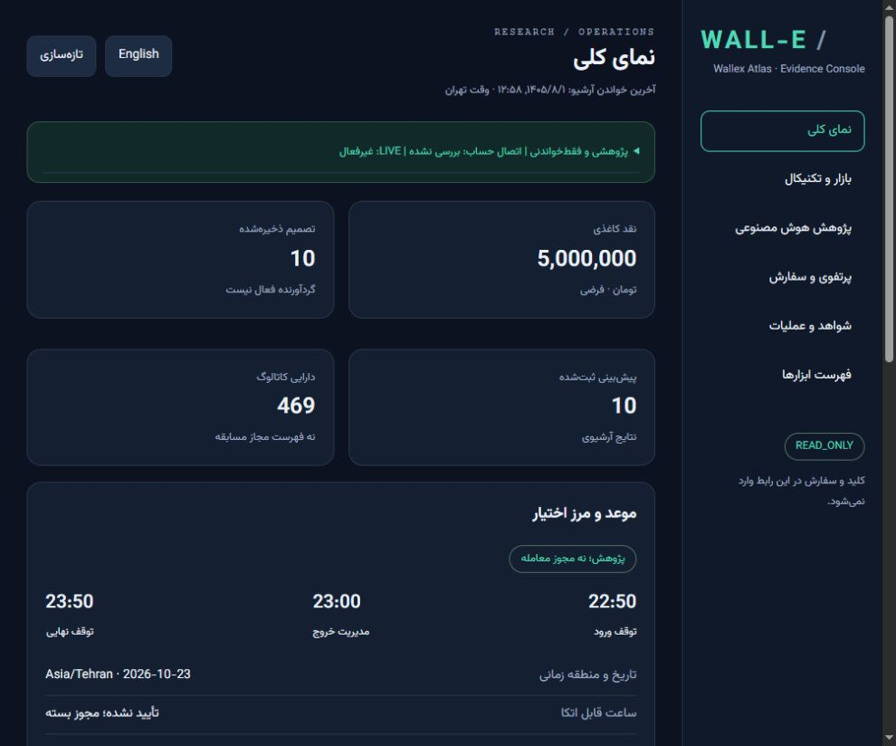
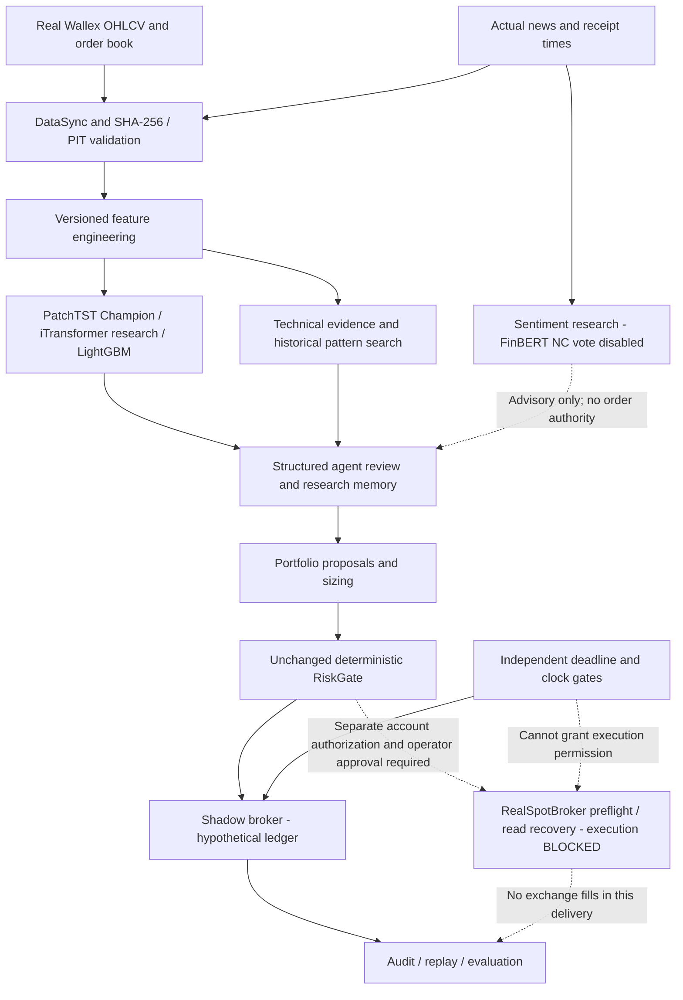
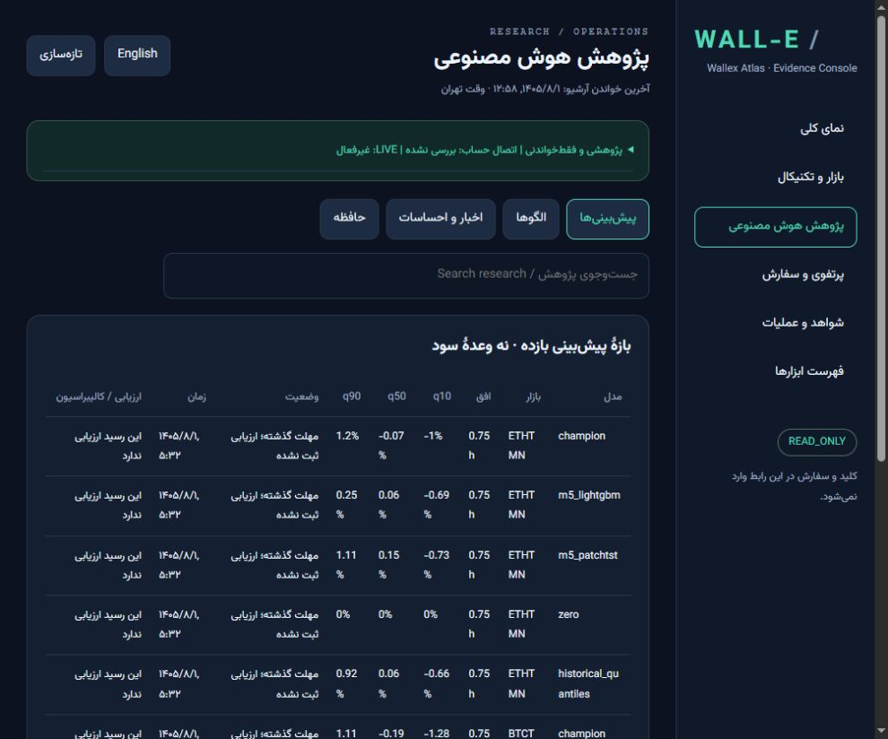

# WALL-E

*Agentic Cryptocurrency Research & Trading System*

WALL-E turns real Wallex market observations into reproducible forecasts,
structured agent reviews and risk-controlled **Shadow research**. Its console
makes the evidence behind a decision inspectable rather than claiming that an
AI explanation proves a profitable trade.

[فارسی](README_FA.md) · [Judge guide](docs/JUDGE_QUICKSTART_EN.md) · [Results](docs/LIMITATIONS_AND_RESULTS.md) · [Current delivery](docs/FINAL_LIVE_UI_REPOSITORY_REPORT_FA.md)



## 1. What is WALL-E?

A Spot/TMN research system for the Wallex algorithmic-trading challenge.
**Real execution remains HARD_DISABLED.** Ordinary wallet funds are not assumed
to be contest credit. No verified out-of-sample economic edge is claimed.

## 2. Key capabilities

- Resumable, demand-driven public-data synchronization and hash/PIT validation.
- Per-asset readiness; an invalid market need not stop healthy markets.
- Versioned multi-timeframe features, quantile models and historical analogues.
- Ten structured review roles, evidence-only memory, audit and decision replay.
- Local bilingual, read-only console with licensed Vazirmatn and real archive data.

## 3. System architecture

Solid edges show implemented research flow. Dashed edges describe the **blocked**
future authorized execution boundary, not currently available live trading.



[Detailed architecture](docs/AGENTIC_ARCHITECTURE_FA.md) · [Decision trace](docs/DECISION_TRACE.md).

## 4. Agent roles

The ten deterministic review roles are not ten independent LLMs. Existing
LangGraph orchestration and SQLite checkpoints persist the workflow. Structured
agreement, disagreement and veto evidence remain available in the console.
No news text or explanation can override the numerical risk gate.

## 5. AI and forecast models

The original PatchTST Champion and its recipe remain unchanged. iTransformer
and LightGBM are research challengers; zero and historical-quantile baselines
are retained. Quantiles are log returns, not guaranteed prices or fills.
No automatic model promotion is enabled. [Model card](docs/MODEL_CARD.md).

## 6. Historical pattern retrieval

Immutable normalized OHLCV windows, SciPy distance search and constrained DTW
support descriptive analogues with availability cutoffs, embargo and temporal
de-overlap. Similarity is not a calibrated trading edge. The existing local
index is not bundled with source. [Explainability](docs/MODEL_AND_SIGNAL_EXPLAINABILITY_FA.md).

## 7. Technical indicators

The registry records formula, warmup, timeframe, missing policy and provenance.
The console exposes Ichimoku, confirmed-swing Fibonacci, trailing SuperTrend,
Bollinger bands, RSI, MACD histogram, volume and research features. Gaps reset
warmup. Latest-candle levels are not backdated across historical candles.
The old simplified SuperTrend feature is not relabelled as the full algorithm.

## 8. News and sentiment

Actual article receipts, publication time and availability are distinct.
Missing sentiment is not neutral. ProsusAI FinBERT weights carry
**CC-BY-NC-SA-4.0**; competition voting/inference is disabled and weights are
not distributed. No external README's claimed return is a WALL-E result.

## 9. Portfolio management

BUY/HOLD/REDUCE/SELL/REBALANCE/STAY_IN_CASH proposals are distinct from broker
execution. Existing sizing, cash reserve, position caps and cost checks remain.
ADD is not authorized by the unchanged risk contract. Multi-leg rebalancing is
not an atomic exchange operation. Shadow capital is explicitly hypothetical.

## 10. Risk management

The deterministic RiskGate remains the sole financial approval point. A model,
LLM, news story or UI cannot relax it. Unknown/pending orders require
reconciliation before a new market order; they are not safe to blindly retry.
Independent clock/deadline restrictions cannot grant risk permission.

## 11. Backtesting and Shadow trading

Only actual archived data are used. No synthetic market fixtures fill absent
history. Costs, temporal splits, limitations and skipped real-data tests must
be reported. Frozen historical sessions must use their original source and
assets, not resume under this changed tree. [Reproducibility](docs/REPRODUCIBILITY.md).

## 12. Live readiness and permissions

The new Spot adapter provides exact Decimal LIMIT serialization, durable client
identity, cumulative fill/fee parsing and read-only reconciliation. **It does
not yet provide released POST/DELETE transport or operator arming.** Positive
real-fill, cancellation and account-conservation E2E remain unverified. This is
an explicit software limitation as well as an account-authorization blocker.

The account key is read only from `WALLEX_API_KEY`, never `pass.txt` or `.env`.
The console never receives keys or sends orders. Do not paste keys into chat.
Read-only account checks cannot prove trade permission or contest identity.
[Official API contracts and release blockers](docs/SPOT_RELEASE_CONTRACT.md).

Deadline: **2026-10-23 23:50 Asia/Tehran = 20:20 UTC**. New entries stop at
22:50 Tehran; exit management starts at 23:00. The independent supervisor has
a persistent high-water clock/HALTED latch but is not an installed service and
does not automatically sell holdings. No guaranteed liquidation is claimed.

## 13. Installation

Observed platform: Windows x64 / Python 3.12. Create an isolated environment;
do not replace the operator's existing environment.

```powershell
git clone https://github.com/Agentic-Hackathon/WALL-E.git
cd WALL-E
python -m venv .venv
.\.venv\Scripts\python -m pip install -r requirements-judge-lock.txt
```

The lock records the previous verified CPU install, not a universal GPU lock.
Private repository access must be granted by the owner.

## 14. Quick start

```powershell
python scripts/judge_preflight.py
$env:PYTEST_DISABLE_PLUGIN_AUTOLOAD='1'
python -m pytest -q
python -m wallex_bot.atlas_console --port 8766
```

Open [the local console](http://127.0.0.1:8766). Preflight is offline and returns
BLOCKED without actual archive/checkpoints; that is not an installation error.
Use the virtual-environment Python explicitly if it is not activated.

Optional **read-only**, bounded supervisor observation (no service installation):

```powershell
python -m wallex_bot.atlas_deadline_supervisor --root atlas_store --duration 60
python -m wallex_bot.atlas_live_readiness --private-read
```

The second command needs an environment key. It does not activate a package,
create a trading account, transfer money, cancel or submit orders.

## 15. Dashboard screenshots

Actual locally saved evidence, not generated demo data:



## 16. Reproducibility and judge guide

[English judge guide](docs/JUDGE_QUICKSTART_EN.md) · [راهنمای داور](docs/JUDGE_QUICKSTART_FA.md)
· [Tool inventory](docs/TOOL_INVENTORY.md). The searchable console discovers
all existing registered tools; it copies CLI commands without executing them.
Private archive, model weights and session state are deliberately excluded.
They require separately approved assets with matching hashes for full replay.

Historical notes and archives are under [legacy](legacy/README.md); active
reports retain their existing paths for compatibility with current consumers.

## 17. Results and limitations

The previous bounded prospective run saved ten forecasts and ten stay-in-cash
decisions, not ten trades. No exchange fills or verified economic benefit are
claimed. The five-million-TMN Shadow balance is not evidence of contest credit.
Current test counts and remaining work are in the [delivery report](docs/FINAL_LIVE_UI_REPOSITORY_REPORT_FA.md).

## 18. Third-party projects and licenses

[Pinned repositories and use](third_party/SOURCES.md) · [Attribution](docs/THIRD_PARTY_ATTRIBUTION.md).
TradingAgents, FinMem and FinRL informed independent Atlas glue; restricted
GPL/LGPL/unlicensed code was not copied. SciPy is used directly under BSD.
Vazirmatn v33.003 is bundled unmodified with its [SIL OFL license](wallex_bot/static/fonts/OFL.txt).
