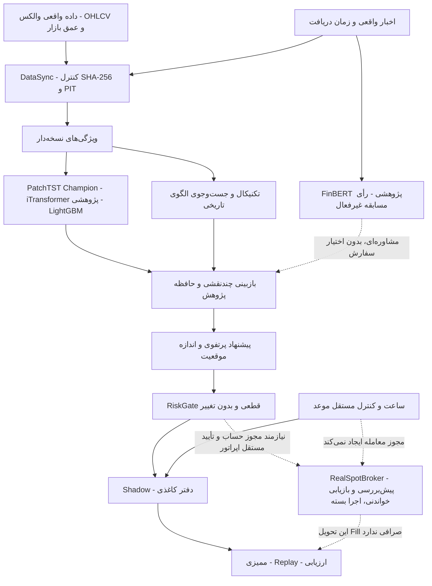

# WALL-E

*Agentic Cryptocurrency Research & Trading System*

سامانهٔ پژوهش و معاملات رمزارز با دادهٔ واقعی والکس، پیش‌بینی احتمالاتی،
بازبینی چندنقشی و کنترل ریسک قطعی. هدف، تصمیم قابل بررسی و بازتولیدپذیر است؛
توضیح هوش مصنوعی به‌تنهایی اثبات سود نیست.

[English](README.md) · [راهنمای داور](docs/JUDGE_QUICKSTART_FA.md) · [گزارش تحویل](docs/FINAL_LIVE_UI_REPOSITORY_REPORT_FA.md)


## ۱. WALL-E چیست؟

پروژهٔ پژوهشی چالش والکس برای Spot با کوت TMN است. **اجرای واقعی همچنان
HARD_DISABLED است.** اعتبار مسابقه از متن قوانین یا موجودی عادی فرض نمی‌شود.
برتری اقتصادی خارج از نمونه اثبات نشده است.

## ۲. قابلیت‌ها

- دریافت تقاضامحور و قابل‌ادامه، کنترل هش و زمان دسترس‌پذیری داده.
- آمادگی مستقل هر بازار، ویژگی‌های چندتایم‌فریم و نسخه‌دار.
- پیش‌بینی Quantile، الگوی تاریخی، حافظهٔ پژوهش و بازبینی ساختاریافته.
- پرتفوی کاغذی، RiskGate، زنجیرهٔ ممیزی و Replay.
- رابط فارسی/انگلیسی محلی با Vazirmatn و اطلاعات واقعی آرشیو.

## ۳. معماری سامانه

خط پیوسته مسیر پژوهشی پیاده‌شده است؛ خط‌چین مسیر اجرای واقعی **بسته** یا
مشاوره‌ای است، نه مجوز معاملهٔ فعال.



[معماری کامل](docs/AGENTIC_ARCHITECTURE_FA.md) · [ردپای تصمیم](docs/DECISION_TRACE.md).

## ۴. نقش‌های Agent

ده نقش بازبینی قطعی داریم، نه ده LLM مستقل. گردش کار LangGraph و SqliteSaver
حفظ شده است. نظر، اختلاف و شواهد قابل مشاهده‌اند؛ خبر یا متن مدل نمی‌تواند
RiskGate را دور بزند.

## ۵. مدل‌های AI و پیش‌بینی

Champion اصلی PatchTST و Recipe آن محفوظ‌اند. iTransformer و LightGBM در
پژوهش و مقایسه با baseline صفر و Quantile تاریخی حضور دارند. خروجی‌ها بازده
لگاریتمی‌اند، نه قیمت یا Fill تضمینی. Promotion خودکار وجود ندارد.
[Model Card](docs/MODEL_CARD.md).

## ۶. بازیابی الگوهای تاریخی

پنجره‌های واقعی و تغییرناپذیر، نرمال‌سازی درون‌پنجره، فاصلهٔ SciPy و DTW
مقید با Embargo و حذف هم‌پوشانی زمانی استفاده می‌شوند. شباهت، اثبات سیگنال
سود نیست. Index محلی همراه سورس منتشر نمی‌شود.

## ۷. اندیکاتورها

Registry تعریف، Warmup، سیاست Missing و منشأ را مشخص می‌کند. رابط Ichimoku،
Fibonacci مبتنی بر Swing تأییدشده، SuperTrend دنباله‌دار، Bollinger، RSI،
MACD و حجم را در دسترس می‌گذارد. Gap باعث شروع مجدد Warmup می‌شود.
سطوح آخرین کندل روی گذشته بازنویسی نمی‌شوند. Recipe قدیمی Champion تغییر نکرده است.

## ۸. اخبار و احساسات

زمان انتشار، دریافت و دسترس‌پذیری متفاوت‌اند. دادهٔ مفقود خنثی فرض نمی‌شود.
وزن‌های ProsusAI FinBERT مجوز **CC-BY-NC-SA-4.0** دارند؛ رأی/Inference مسابقه
غیرفعال است و وزن‌ها منتشر نمی‌شوند. نتیجهٔ README دیگران نتیجهٔ پروژه نیست.

## ۹. مدیریت پرتفوی

BUY، HOLD، REDUCE، SELL، REBALANCE و STAY_IN_CASH پیشنهادند، نه اجرای خودکار.
سقف موقعیت، ذخیرهٔ نقد و هزینه لحاظ می‌شوند. ADD در قرارداد فعلی مجاز نیست.
Rebalance چندمرحله‌ای تراکنش اتمیک صرافی نیست. سرمایهٔ Shadow فرضی است.

## ۱۰. مدیریت ریسک

RiskGate مستقل و قطعی تنها مرز تأیید مالی است. سفارش مبهم/باز پیش از هر
سفارش جدید نیازمند تطبیق است و نباید کورکورانه تکرار شود. کنترل ساعت و موعد
فقط اختیار را محدود می‌کند، نه اینکه مجوز مالی بدهد.

## ۱۱. Backtest و Shadow

فقط دادهٔ واقعی؛ Gap، قیمت یا نتیجهٔ ساختگی تولید نمی‌شود. هزینه، Split زمانی
و محدودیت‌ها باید گزارش شوند. نشست‌های منجمد قبلی با این سورس جدید Resume
نمی‌شوند؛ Checkout و فایل‌های اصلی لازم‌اند. [بازتولیدپذیری](docs/REPRODUCIBILITY.md).

## ۱۲. آمادگی LIVE و مجوزها

آداپتور جدید Decimal، هویت پایدار سفارش، تفسیر اجرای تجمعی و کارمزد، و
Reconciliation خواندنی دارد. **POST/DELETE مالیِ قابل بهره‌برداری و ARM اپراتور
هنوز پیاده نشده‌اند.** آزمون مثبت Fill، Cancel و بقای موجودی واقعی هم تأیید
نشده است؛ این‌ها مانع نرم‌افزاری‌اند، نه صرفاً نبود کلید.

کلید فقط از `WALLEX_API_KEY` خوانده می‌شود، نه `pass.txt` یا `.env`.
رابط هیچ کلید یا کنترل مالی ندارد. مطالعهٔ خواندنی حساب، مجوز معامله را ثابت
نمی‌کند. [قرارداد رسمی و موانع انتشار](docs/SPOT_RELEASE_CONTRACT.md).

موعد: **۲۳ اکتبر ۲۰۲۶، ۲۳:۵۰ تهران = ۲۰:۲۰ UTC**؛ توقف ورود ۲۲:۵۰، خروج
۲۳:۰۰. ناظر مستقل با ساعت High-water و توقف پایدار اضافه شده، اما سرویس دائمی
نصب نشده و خروج خودکار انجام نمی‌دهد. فروش کامل تضمین نمی‌شود.

## ۱۳. نصب

محیط مشاهده‌شده Windows x64 و Python 3.12 است. محیط اصلی اپراتور را تغییر ندهید.

```powershell
git clone https://github.com/Agentic-Hackathon/WALL-E.git
cd WALL-E
python -m venv .venv
.\.venv\Scripts\python -m pip install -r requirements-judge-lock.txt
```

Lock محیط CPU نصب‌شدهٔ قبلی است؛ تضمین یکسانی GPU یا نتیجهٔ مالی نیست.

## ۱۴. شروع سریع

```powershell
python scripts/judge_preflight.py
$env:PYTEST_DISABLE_PLUGIN_AUTOLOAD='1'
python -m pytest -q
python -m wallex_bot.atlas_console --port 8766
```

[رابط محلی](http://127.0.0.1:8766). اگر محیط فعال نیست، Python داخل `.venv`
را صریح اجرا کنید. Preflight آفلاین است و بدون آرشیو/Checkpoint واقعی BLOCKED
می‌شود؛ این رفتار ایمن است، نه خرابی نصب.

مشاهدهٔ مستقل و محدود موعد، بدون سفارش یا نصب سرویس:

```powershell
python -m wallex_bot.atlas_deadline_supervisor --root atlas_store --duration 60
python -m wallex_bot.atlas_live_readiness --private-read
```

فرمان دوم نیازمند کلید محیطی است. هیچ حساب/پکیجی فعال و هیچ وجهی منتقل نمی‌کند.

## ۱۵. تصاویر واقعی رابط


## ۱۶. راهنمای داور و بازتولید

[راهنمای فارسی](docs/JUDGE_QUICKSTART_FA.md) · [English](docs/JUDGE_QUICKSTART_EN.md)
· [فهرست ابزارها](docs/TOOL_INVENTORY.md). رابط ابزارها را کشف و فرمان را کپی
می‌کند، نه اینکه اجرا کند. آرشیو خصوصی، وزن و نشست همراه سورس نیستند؛ برای
بازتولید کامل، فایل‌های مجاز با Hash مطابق لازم‌اند.

مطالب تاریخی به [legacy](legacy/README.md) منتقل شده‌اند. مسیر گزارش‌های فعال
برای سازگاری با مصرف‌کنندگان فعلی حفظ شده است.

## ۱۷. نتایج و محدودیت‌ها

اجرای محدود قبلی ده پیش‌بینی و ده تصمیم ماندن در نقد ثبت کرده، نه ده معامله.
Fill صرافی و سود خارج از نمونه ثابت نشده است. نقد کاغذی پنج‌میلیونی اثبات
اعتبار مسابقه نیست. تعداد تست و کار باقی‌مانده در [گزارش تحویل](docs/FINAL_LIVE_UI_REPOSITORY_REPORT_FA.md) آمده است.

## ۱۸. منابع و مجوزها

[Commit و مجوز منابع](third_party/SOURCES.md) · [انتساب](docs/THIRD_PARTY_ATTRIBUTION.md).
TradingAgents، FinMem و FinRL الهام مفهومی بوده‌اند؛ کد GPL/LGPL/بی‌مجوز کپی
نشده است. SciPy با BSD مستقیم استفاده می‌شود. Vazirmatn v33.003 بدون تغییر با
[مجوز SIL OFL](wallex_bot/static/fonts/OFL.txt) ارائه شده است.
